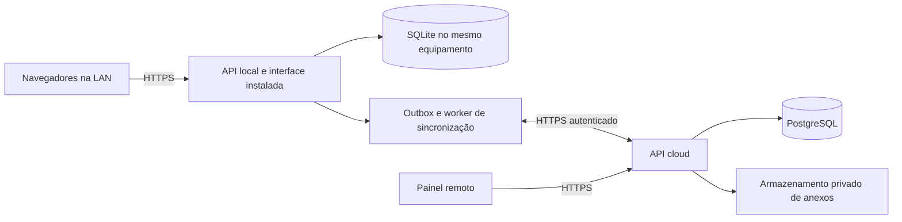

# SDD — System Design Document

> Atualização de 21/10/2026: Supabase gerenciado aprovado; servidor local rejeitado. [ADR 006](adr/006-supabase.md) prevalece sobre a proposta local/offline abaixo. As seções anteriores são histórico pendente de revisão detalhada; não comprovam implementação.

Versão 0.1 · 20/10/2026 · Decisões propostas, sujeitas à prova técnica B01.

## 1. Arquitetura escolhida para o piloto

Monólito modular, com aplicação web responsiva, API local no equipamento da igreja e API em nuvem. Proposta de stack: TypeScript, React/Vite para interface, Node.js com Fastify para APIs, SQLite local e PostgreSQL em nuvem. Fixar versões suportadas e dependências após o spike; não há provedor contratado. SQL e migrações separados por banco; não presumir equivalência de recursos.



Durante queda da internet, o equipamento e a rede local precisam continuar funcionando. No MVP, navegador sem LAN não grava dados de domínio. Servir interface e arquivos estáticos pelo equipamento local permite abertura sem internet; não depender de CDN nem login externo naquele momento. Dispositivo precisa ter sido provisionado e operador habilitado previamente.

Não compartilhar arquivo SQLite por pasta de rede. Clientes acessam API local; somente processos no mesmo host abrem o banco. Isso segue as restrições documentadas de [SQLite/WAL](https://www.sqlite.org/wal.html).

## 2. Fronteiras e autoridade de escrita

Módulos: identidade; pessoas/PRI; suprimentos; ações; rede de cuidado; casa/custos; escalas/campanhas; relatórios; sincronização/auditoria. Acesso entre módulos por serviços explícitos; proibir acesso arbitrário às tabelas de prontuário.

**MVP com uma autoridade operacional por unidade:** servidor local escreve estoque, atendimentos, PRI e ações. Painel cloud consulta réplicas e administra identidade/configurações. Não permitir editar o mesmo domínio local e cloud simultaneamente. Configurações cloud entram na fila de recebimento; mudança de permissão tem prioridade e é aplicada antes de novos eventos no servidor.

No piloto, delegação offline assinada por operador/dispositivo expira em até 24 h, hipótese a validar. Habilitar somente perfis previamente provisionados, com credencial local protegida e bloqueio por tentativas. Administrador cloud usa autenticação reforçada. Revogação imediata não é garantida sem conexão; mostrar expiração e bloquear novas escritas no vencimento. Procedimento de contingência é manual, sem extensão silenciosa da sessão.

Transferência de autoridade exige congelar escrita, drenar fila, reconciliar e emitir novo epoch de autoridade. Falha de equipamento não autoriza segundo escritor automaticamente. Operação móvel isolada e multiunidade ficam para ADR posterior, incluindo cotas de estoque por dispositivo.

## 3. Modelo de dados lógico

Todas as entidades operacionais carregam `id` UUID gerado na origem, `organization_id`, `unit_id`, `version`, horários UTC e autor. Datas de validade são datas civis; apresentação em America/Sao_Paulo. Vínculos sensíveis devem respeitar organização e unidade também nas chaves estrangeiras.

| Grupo | Entidades e campos centrais |
|---|---|
| Identidade | User, Role, Permission, Assignment, Device, OfflineGrant, AuthorityEpoch |
| Pessoas | Person(nome social, identificação opcional), Case(person_id, responsável, fase principal, status), Encounter, FollowUp |
| Conteúdo restrito | CaseNote(categoria, autor, visibilidade), PhaseEvent(origem, destino, motivo), Attachment(classificação) |
| Suprimentos | Donor, Donation, DonationLine, Item(categoria, unidade base), Lot(validade, estado), Location |
| Estoque | StockMovement(tipo, quantidade, lote, origem/destino, comando), Reservation(action_id, lote, quantidade, status) |
| Ações | OutreachAction(status, data), RoutePoint, TeamMember, Distribution, Reconciliation |
| Rede | Partner, VacancySnapshot(data de confirmação), Referral(status, requisitos, aceite, transporte), Training, Opportunity, Placement |
| Casa e recursos | Bed, Stay(entrada/saída), Expense(centavos, competência, status), SponsorQuota, Payment |
| Escalas/campanhas | ServiceEvent, ConsumptionTemplate, ConsumptionExecution, SpeakerAssignment, Campaign, CampaignContribution |
| Controle | CommandReceipt, OutboxEvent, InboxReceipt, SyncCursor, Conflict, AuditEvent, DeletionTombstone |

Saldos e métricas são projeções de movimentos e eventos, reconstruíveis. Índices por unidade/status/data, documento normalizado quando permitido e lote/validade. Identificador civil não obrigatório e não usado como chave primária. Candidatos a duplicidade não expõem dados de outro caso ao operador sem permissão.

## 4. Contratos mínimos

API JSON versionada `/v1`; validação de esquema na borda e regras no domínio. `organization_id` e `unit_id` são derivados da sessão e atribuição autorizada, nunca aceitos como autorização fornecida pelo cliente.

| Operação | Contrato resumido |
|---|---|
| POST /people | Nome/apelido mínimo; retorna id e versão |
| POST /donations | Cabeçalho e itens; triagem separada |
| POST /stock/movements | Comando tipado; ajuste exige motivo e permissão |
| POST /actions/{id}/reserve | Linhas de lote/quantidade; transação com verificação de disponível |
| POST /actions/{id}/close | Entregas, perdas, devoluções e versão esperada |
| POST /cases/{id}/encounters | Atendimento e próximo passo, sem exigir nota pastoral |
| POST /cases/{id}/phase-events | Fase, motivo, versão esperada; permissão de caso |
| POST /sync/push | Lote de eventos ordenado; resultado individual e cursor confirmado |
| GET /sync/pull?cursor=... | Alterações autorizadas paginadas e tombstones |

Comandos usam `Idempotency-Key` e `expected_version` quando alteram agregados existentes. Repetição da mesma chave e payload retorna resultado original; mesma chave com payload diferente retorna 409. Respostas: 400 formato, 401 sessão, 403 acesso, 409 conflito/saldo, 422 regra de domínio. Sem PII no texto de erros. Paginação obrigatória.

Exemplo de envelope de sincronização:

```json
{
  "event_id": "uuid",
  "device_id": "uuid",
  "authority_epoch": 1,
  "local_sequence": 42,
  "aggregate_type": "stock_movement",
  "aggregate_id": "uuid",
  "base_version": 3,
  "schema_version": 1,
  "occurred_at": "2026-10-20T15:00:00Z",
  "payload": {"movement_type": "issue", "lot_id": "uuid", "quantity": 5}
}
```

Autenticar dispositivo e verificar assinatura/credenciais, atribuição e escopo; campos do envelope não são prova de identidade.

## 5. Protocolo de sincronização

1. API local valida autorização e domínio; grava mudança, auditoria, recibo idempotente e outbox na mesma transação SQLite. Só então confirma ao navegador.
2. Worker envia eventos em sequência por agregado e dependências; operação confirmada localmente permanece pendente até ack durável cloud.
3. Cloud verifica epoch, schema, permissão e dependências. Recibo único por organização/evento e alteração entram na mesma transação PostgreSQL.
4. Ack individual marca evento sincronizado. Timeout após commit remoto causa reenvio seguro. Nunca apagar evento apenas por tentativa de envio.
5. Pull usa cursor monotônico do servidor, sem depender do relógio do dispositivo. Grava inbox e mudança local atomicamente; avança cursor só após commit.
6. Retentativa com backoff exponencial e jitter; falha permanente entra em quarentena visível com motivo e ação. Resolução cria evento corretivo, preservando origem.

Eventos derivados e relatórios usam a mesma deduplicação. Não reexecutar baixa de estoque ao receber uma réplica. Estados: pendente → enviando → confirmado, ou falha/conflito. Crash em “enviando” volta a pendente.

**Conflitos:** controle otimista por versão; nunca usar último horário como desempate para notas, saldo, vagas ou camas. Notas são acrescentadas e retificadas, sem sobrescrita silenciosa. Alteração de fase desatualizada pede revisão. Revogação durante offline pode rejeitar evento já realizado fisicamente: conservar evidência e encaminhar para reconciliação autorizada, sem apagar a entrega.

Em falha permanente de um agregado, pausar sua sequência e continuar agregados independentes. Dependências ausentes aguardam, não são descartadas. Migração de schema deve manter compatibilidade com cliente offline por uma janela proposta de sete dias; incompatibilidade bloqueia atualização até backup e resolução.

## 6. Concorrência e consistência

Reserva e entrega executam transações locais serializadas para escrita; validar saldo dentro da transação, nunca apenas na tela. SQLite usa busy timeout e tratamento explícito de disputa. Registro imutável de movimentação e chave única por comando impedem dupla baixa. PostgreSQL protege escrita cloud com transações, unicidade e bloqueio/versão apropriados.

Ocupação de camas exige verificação transacional de sobreposição. Disponibilidade de parceiros é fotografia informativa; reserva real exige confirmação humana. Relatórios exibem unidade, período, última sincronização e registros pendentes.

## 7. Segurança, anexos e continuidade

TLS protege dados em trânsito; não é, por si só, criptografia ponta a ponta: APIs e bancos processam conteúdo. Proteger disco do equipamento, banco cloud e backups, mantendo chaves separadas e acesso mínimo. Não alegar conformidade total apenas por usar HTTPS.

No PostgreSQL, RLS pode complementar filtros de aplicação. Testar com usuário de aplicação sem privilégios de proprietário/bypass, conforme [documentação de políticas](https://www.postgresql.org/docs/17/ddl-rowsecurity.html). SQLite exige escopo e autorização no serviço local, sem equivalência automática a RLS.

Anexos ficam fora do primeiro MVP. Quando habilitados: armazenamento privado, metadados restritos, validação de tipo/tamanho, quarentena e URLs temporárias após autorização; fila própria por hash e checksum, sem bloquear atendimento textual. Cache do navegador não deve armazenar respostas PRI indiscriminadamente. [Service workers exigem contexto seguro](https://developer.mozilla.org/en-US/docs/Web/API/Service_Worker_API); eventual PWA precisa de provisionamento HTTPS válido na LAN, não apenas certificado do domínio cloud.

Backup local diário consistente via mecanismo de backup SQLite, incluindo mudanças pendentes; cópia criptografada fora do equipamento e recuperação ensaiada. Nuvem com backup diário e política de recuperação contratada. Hipótese de retenção operacional de backup: 30 dias, sujeita à política institucional. Backup não é simples cópia do arquivo ativo em WAL.

Restauração: isolar escritor → validar backup → recuperar outbox/recibos → comparar cursor cloud → deduplicar reenvio → validar saldos e casos → liberar escrita. Alertar espaço em disco, falha de backup, fila mais antiga e expiração de credenciais; não registrar conteúdo pessoal na telemetria.

## 8. Estrutura proposta do repositório

```text
apps/web/             interface
apps/local-api/       API e serviço no equipamento
apps/cloud-api/       API remota e workers
packages/domain/      regras compartilhadas sem I/O
packages/contracts/   esquemas, envelopes e versões
packages/sync/        protocolo e idempotência
infra/migrations/     sqlite/ e postgres/
tests/                integração, segurança, E2E e recuperação
docs/                 especificações e ADRs
```

## 9. Decisões e riscos

| ADR | Decisão | Consequência/revisão |
|---|---|---|
| 001 | Monólito modular | Menor carga operacional; revisar se houver necessidade comprovada de isolamento |
| 002 | Servidor local com SQLite | Atende balcão sem internet; depende de LAN, energia e suporte local |
| 003 | Um escritor operacional por unidade | Evita estoque concorrente desconectado; rua isolada exige novo desenho |
| 004 | PostgreSQL cloud e sincronização explícita | Relatórios e governança central; protocolo é trabalho de produto, não recurso presumido |
| 005 | Anexos após piloto | Reduz superfície sensível e complexidade da fila inicial |

Riscos prioritários: perda do equipamento antes de backup, permissões desatualizadas offline, contagem física incorreta, duplicidade de pessoas e operação sem suporte local. B01 precisa demonstrar restart, idempotência, conexão HTTPS na LAN e restore antes de expandir telas.
